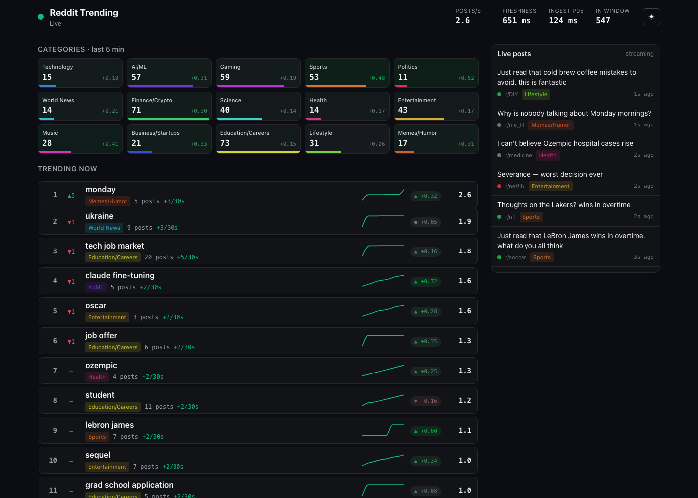
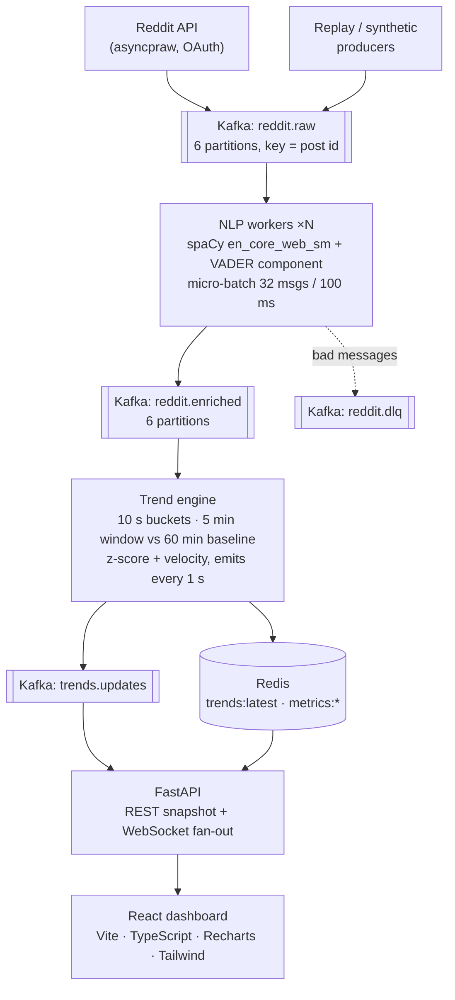
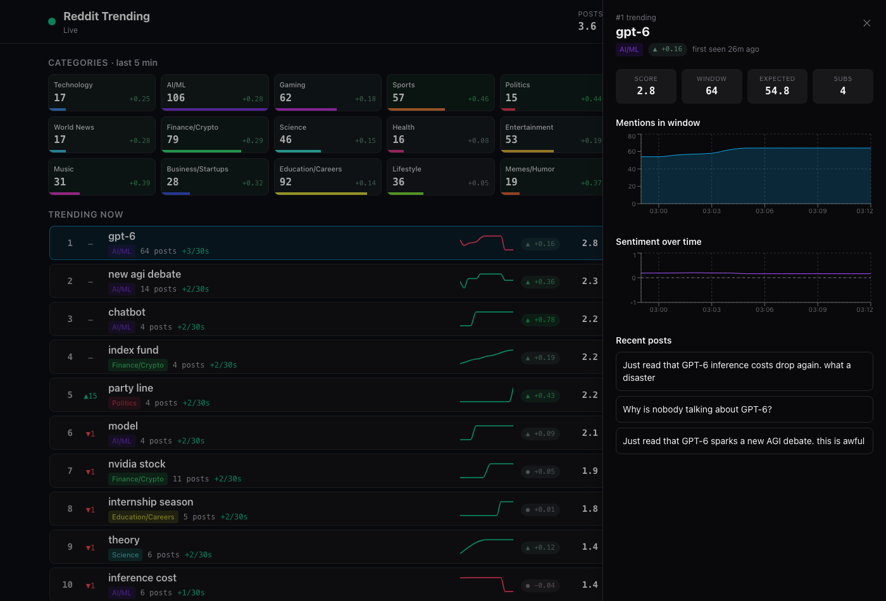
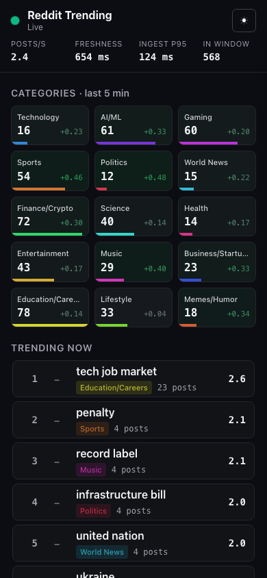
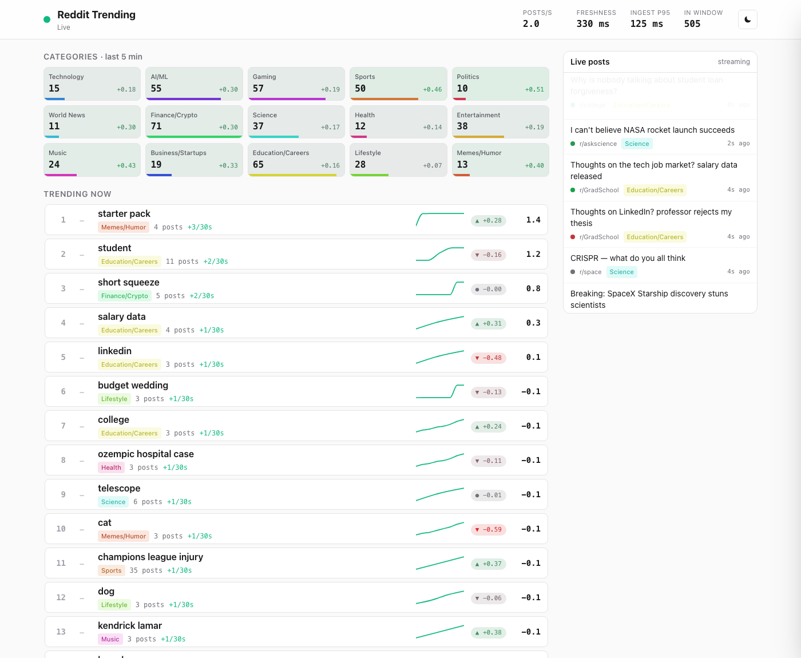

# Real-Time Reddit Trending Pipeline

An end-to-end streaming system that ingests Reddit posts through **Kafka**, enriches them with
**spaCy** NLP (keyphrases, entities, a 15-way category, VADER sentiment), detects trending topics
over sliding windows, and pushes live updates to a **React** dashboard over **FastAPI WebSockets**.



<!-- BENCH-SUMMARY -->

## Architecture



Every message carries timestamps (`ingested_at`, `processed_at`, `generated_at`,
`max_source_ingested_at`, `server_sent_at`), so latency and freshness are measured, not estimated.

## Quick start (one command)

Requirements: Docker (with Compose v2) and `make`.

```bash
git clone https://github.com/raiyana9/reddit-trending-pipeline.git
cd reddit-trending-pipeline
cp .env.example .env
make demo
```

`make demo` builds every image, starts Kafka (KRaft), Redis, the NLP worker, trend engine, API
and dashboard, and replays `data/sample_posts.jsonl` at 10× real time in a loop.

| | |
|---|---|
| Dashboard | http://localhost:3000 |
| REST | http://localhost:8000/api/trends · `/api/categories` · `/api/metrics` · `/docs` |
| WebSocket | `ws://localhost:8000/ws/trends` (also `/ws/posts`) |

Stop everything with `make down`. Scale NLP workers with `make scale-workers`
(`docker compose up -d --scale nlp_worker=3`).

### Live Reddit data

Create a Reddit **script** app at <https://www.reddit.com/prefs/apps>, put `REDDIT_CLIENT_ID`,
`REDDIT_CLIENT_SECRET` and a descriptive `REDDIT_USER_AGENT` in `.env`, then run `make live`.
The producer streams new submissions from the ~70 seed subreddits in
[`config/categories.yaml`](config/categories.yaml), backs off with jitter on 429/5xx, dedups ids
in Redis for 48 h and SHA-256 hashes every author name before it reaches Kafka.

## Components

| Path | What it does |
|---|---|
| [`services/producer`](services/producer) | `reddit` (asyncpraw stream), `replay` (JSONL at `--speed`× or `--rate`/s), `synthetic` (template posts, `--inject-trend` spikes) |
| [`services/nlp_worker`](services/nlp_worker) | Consumer group `nlp-workers`; spaCy pipeline with a registered `vader_sentiment` component; topic extraction, entity filter, 15-way classifier; DLQ |
| [`services/trend_engine`](services/trend_engine) | Sliding-window scoring, near-duplicate merging, 1 s `TrendUpdate` emits; rebuilds state from Kafka on restart |
| [`services/api`](services/api) | FastAPI: `/health`, `/api/trends`, `/api/categories`, `/api/metrics`, `WS /ws/trends`, `WS /ws/posts` |
| [`frontend`](frontend) | React dashboard: status/throughput/freshness header, animated top-20, category grid, topic drawer, live ticker |
| [`shared`](shared) | Pydantic message schemas, settings, Kafka factories, JSON logging, metrics |
| [`scripts`](scripts) | `create_topics.py`, `record_sample.py`, `benchmark.py`, `wait_ready.py` |

### NLP

- **Topics:** noun chunks + named entities (ORG, PERSON, GPE, PRODUCT, EVENT, WORK_OF_ART, NORP),
  trimmed of determiners/pronouns/stopwords at the edges, lemmatized (proper nouns keep their
  surface form), lowercased, deduped, Reddit noise removed (`edit`, `tl;dr`, `op`, `r/…`); up to 8,
  entities first, then longer phrases.
- **Category:** softmax over `5.0 × subreddit prior + 1.0 × keyword matches (1.5 in title) + 0.3 ×
  entity-label hints`, with lemma-aware `PhraseMatcher`s built from the YAML seeds.
- **Sentiment:** VADER compound score as a real `@Language.component` (`doc._.sentiment`).

### Trend scoring

For each topic, in 10-second buckets:

```
expected   = baseline_count / observed_baseline_s × window_s       (60 min baseline, 5 min window)
z          = (count_window − expected) / sqrt(expected + 1)
velocity   = count(last 30 s) − count(previous 30 s)
z_velocity = max(velocity, 0) / sqrt(expected_30s + 1)
score      = (z + z_velocity) × (1 + 0.05 × min(distinct_subreddits − 1, 6))
```

Topics need ≥ 3 mentions in the window; near-duplicates (`laker`/`lakers`, `gta 6`/`gta 6 release
date` within one category) are merged. The velocity term is what lets a brand-new spike reach the
top within seconds. See [DECISIONS.md](DECISIONS.md) for the reasoning.

## Development

Requirements: [uv](https://docs.astral.sh/uv/), Node 20+, Docker.

```bash
make install                 # uv sync (Python 3.12 + deps) and npm install
make up                      # Kafka + Redis, create topics

uv run python -m services.nlp_worker &
uv run python -m services.trend_engine &
uv run python -m services.api &
make demo-produce            # replay the sample at 10x
make frontend-dev            # http://localhost:5173
```

| Command | |
|---|---|
| `make test` | Python unit tests + Vitest |
| `make test-integration` | Kafka/Redis integration tests (starts infra) |
| `make lint` | ruff, mypy, eslint, tsc |
| `make bench` | Throughput, latency and freshness benchmarks → [BENCHMARKS.md](BENCHMARKS.md) |
| `make logs` | Tail all container logs |

CI ([.github/workflows/ci.yml](.github/workflows/ci.yml)) runs ruff, mypy, unit tests,
integration tests against Kafka/Redis in Compose, the frontend lint/type-check/tests/build, and a
Docker build of every image.

### Configuration

All configuration is via environment variables (`pydantic-settings`); every variable is documented
in [.env.example](.env.example). Highlights: `NLP_BATCH_SIZE` / `NLP_FLUSH_MS` (latency vs.
throughput), `TREND_WINDOW_S` / `TREND_BASELINE_S` / `TREND_EMIT_INTERVAL_S`, `SPACY_MODEL`
(`en_core_web_md` is downloaded at image build time via `--build-arg SPACY_MODEL=...`).

### Message schemas

Defined in [`shared/schemas.py`](shared/schemas.py), JSON-encoded, all with `schema_version`:
`RawPost` (`reddit.raw`), `EnrichedPost` (`reddit.enriched`), `TrendUpdate` (`trends.updates`),
`DeadLetter` (`reddit.dlq`).

## Screenshots

| Topic drawer | Mobile |
|---|---|
|  |  |



## Data and privacy

Uses the official Reddit API through an authenticated OAuth app with a descriptive user agent; no
HTML scraping. Author names are SHA-256 hashed before they enter Kafka, and raw data is retained for
24 h (topic retention). The committed `data/sample_posts.jsonl` is synthetic.
